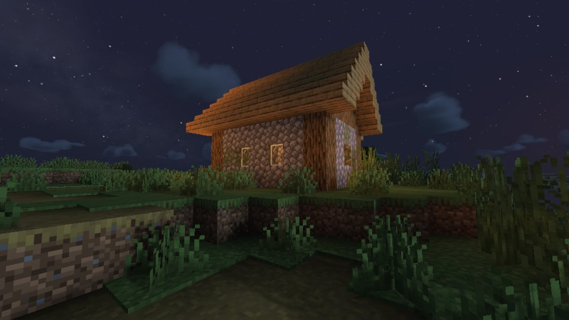

# Sunsun Shader

An original native Horizon shader pack with directional sun and moon shadows,
clear blue daylight, coloured shade, layered clouds and reflective water.

**0.2.0-rc1 is a pre-release.** It is built for the ordinary public Nightly,
with Medium as its default. The visual review compares nineteen fixed scenes
against 0.1.1, including canopy light, grazing water, lit village windows and rain.





## Install

Tested in **Horizon Nightly 2026-11-13 · 9f42064**, the public launcher Nightly
for Minecraft Java Edition 26.3. The release uses shader API **0.1** and does not
require an experimental HDR environment switch.

Download [sunsunshader-0.2.0-rc1.hshader](https://github.com/lkjsxc/sunsunshader/releases/download/v0.2.0-rc1/sunsunshader-0.2.0-rc1.hshader),
put it in the game's `shaderpacks/` folder, and select **Sunsun Shader** under
Options → Video Settings → Shaders → Shader Packs. Keep one installed Sunsun
archive. Folder installation also works as `shaderpacks/sunsunshader/`.

[Version 0.1.1](https://github.com/lkjsxc/sunsunshader/releases/tag/v0.1.1) remains
available. This release candidate changes the appearance substantially and adds
work at Medium; the measured software comparisons below explain that cost.

## What changed

- Genuine terrain, building, cutout foliage and available entity caster maps now
  control directional light with useful contrast. Blocker separation broadens
  the shadow edge. Coloured sky fill stays independent of the direct shadow.
- A clearer blue atmosphere, warm sun, cool shade and continuous highlight
  shoulders replace the broad white daytime veil. Partly covered shade keeps
  material colour. Smoothed eye light provides modest exposure adaptation.
- Water reflects the original sky and cloud field at Medium, with Fresnel,
  screen-space shore hits, filtered waves at several scales, a broad sun path,
  depth absorption, refraction and a shallow edge transition.
- Cumulus varies in size and height, with eroded boundaries, shaded bases and
  low-sun rims. A separate high layer has projected footprint filtering.
- Contact shading adds depth where visible surfaces meet. Foliage backlight and
  gentle world-anchored plant wind use the same vertices in the caster pass.
- Varied stars and a soft band accompany moonlight; existing light sources retain
  warm falloff, emitter colour and restrained bloom. High adds shadowed air shafts.

## Profiles and cost

**Medium is the default.** All three profiles use a 1536×1536 shadow map with a
128-block half-distance. Low reduces filter work, rather than removing real shadows.

| Work | Low | Medium | High |
| --- | ---: | ---: | ---: |
| Shadow filter samples per map |4|8|12|
| Blocker-search depth samples |0|8|12|
| Contact-shading depth samples |0|8|12|
| Clear-cloud traversal cap |8 cells|14 cells|22 cells|
| Density points per intersected cloud lobe |2|3|5|
| Reflected-cloud traversal cap |None|10 cells|16 cells|
| Screen reflection depth steps |None|12 + up to 4 refinement|24 + up to 4 refinement|
| Air shaft samples |Off|Off|10|

The cloud counts are bounds with geometric early exits; clouds are procedural
arithmetic, not texture reads. A shadow comparison lookup performs native 2×2 PCF;
opaque and transmitting maps are sampled separately. Full runtime counts and
measurement methodology are in the release review.

The initial sequential run recorded the following median repeat means. Each ratio
uses the matching scene's **0.1.1 Medium** baseline: 168.9 ms at noon, 259.2 ms over
water and 371.1 ms in the forest.

| Profile | Noon | Grazing water | Forest, 08:00 | Three-scene geometric mean |
| --- | ---: | ---: | ---: | ---: |
| Low | 261.1 ms · 1.55× | 263.3 ms · 1.02× | 517.0 ms · 1.39× | 1.30× |
| **Medium** | **307.5 ms · 1.82×** | **458.5 ms · 1.77×** | **616.9 ms · 1.66×** | **1.75×** |
| High | 292.0 ms · 1.73× | 376.1 ms · 1.45× | 424.7 ms · 1.14× | 1.42× |

Medium took **66–82% more frame time** in these three sequential comparisons
(74.9% by their geometric mean). This is an observed run result on a shared host.
High measured faster than Medium in this sequence despite its greater sample
budget; changing machine load and different sampling periods make that ordering
unsuitable for choosing a profile. The [cost review](https://github.com/lkjsxc/sunsunshader/releases/download/v0.2.0-rc1/costs.md)
retains repeat spread, feature ablations, equal-duration Medium/High/Medium
controls and a fresh old/new forest comparison.

The equal-duration forest follow-up measured **466.5 → 517.4 → 481.3 ms**
for Medium → High → Medium, placing High 7.5–10.9% above the bracketing Medium
measurements. A later consecutive comparison measured **553.0 ms for 0.1.1 Medium**
and **550.2 ms for rc1 Medium** (about **1.00×**, with overlapping repeat ranges).
These controls establish substantial run-to-run variation; the initial 1.75×
figure is not a general overhead estimate.

These are 960×540 Mesa software-renderer measurements on the same scene with eight
worker threads, compared with 0.1.1 Medium. They are not hardware GPU benchmarks.
The manifest's 4 ms at 1920×1080 remains a design target, not a measured result.

Options cover exposure, air density, clouds, shadows, terrain reflections, wave strength,
contact shading, plant wind, weather detail and bloom. Depth of field, camera
motion blur and vignette are off by default.

## Review evidence and remaining limits

[Release and review files](https://github.com/lkjsxc/sunsunshader/releases/tag/v0.2.0-rc1)
include the installable archive, SHA-256, public Nightly gate receipt, comparison
sheet and report. Each comparison cell is a native 960×540 capture from the same
world, pose, calendar time and weather. The README pictures are native captures of these exact pack bytes; the published
download is independently rechecked and replayed. Scene pixels are not repainted
or graded outside the pack.
The earlier promotional film is unchanged and was not rendered or uploaded again.

**Water remains the weakest visual element:** reflected cloud masses are too soft,
and long swells retain a regular rhythm at grazing angles. The original night and
End views improve more modestly than daylight. Outward window glow and High's air
shafts remain restrained. The exposure supplement demonstrates a shallow overhang,
so it does not establish readability for every deep cave mouth.

The public Nightly imposes several further limits:

- Entity materials retain native lighting. Offscreen entity casters can leave
  the native shadow map; a pack cannot repair that culling policy.
- Screen-space reflections cannot see offscreen shore or hidden objects. Misses
  return coherent procedural sky/cloud radiance. The native planar mirror has
  no exposed terrain mask and contains a different sky, so it is not used as
  an inaccurate fallback. Waves change normals and refraction, not the water mesh.
- Its world frame stores bounded gamma colour. Source and final shoulders retain
  colour but cannot restore a true HDR world buffer. Native transparent draws
  still blend in gamma space.
- The moon retains the game's phase texture with a halo. API 0.1 exposes neither
  a moon-off control nor its phase value. General ray queries, local-light
  shadow maps and arbitrary bounce-light transport are unavailable.
- Contact shading sees visible solid terrain. Plant and cloud motion have no
  object-motion guide; the pack uses spatial edge filtering, without temporal
  accumulation. Snow and auroras use the camera biome.

## Build and check

Python 3.11+, Git and stable Rust are required.

```sh
python3 tools/release.py check --self-test
python3 tools/release.py build
```

Both commands validate the separately pinned Nightly and API 0.2 development
variants through their unmodified Horizon validators. `--target nightly` builds
this 0.2.0-rc1 release; the separate `pack-main/` remains the 0.1.1 development visual
baseline and is not the public Nightly download. Outputs go to `dist/`.

The ordinary-game admission check matters: this Nightly's standalone parser
accepts experimental features the ordinary game refuses. CI includes negative
refusal tests as well as the exact packed-file check. The permanent Nightly
source tag is `nightly-source/2026-11-13-9f42064`; revision, distribution digest
and source-policy digest are pinned in [compatibility/horizon.json](compatibility/horizon.json).

After validating and reviewing the final bytes, publish with:

```sh
python3 tools/release.py release dist/sunsunshader-0.2.0-rc1.hshader --notes release-notes.md --prerelease
```

Publication rechecks those bytes, rebuilds for byte identity, and refuses a dirty
checkout, an unpushed source commit or a mismatching tag. Release-candidate versions
are always marked as pre-releases. See [tools/README.md](tools/README.md) for source
cache controls and updating the public Nightly pin.

All shader code is original and licensed under Apache-2.0. Published mathematical
methods are credited in source comments. No other shader pack is used as source.
