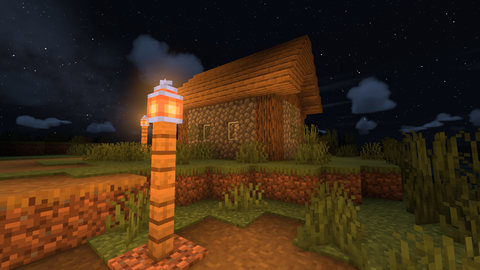

# Sunsun Shader

Sunsun Shader is a native shader pack for Horizon, the Minecraft client written in Rust. It provides dark unlit Overworld spaces, directional shadows, clear blue daylight, layered clouds, reflective water and optional local light haze.

**0.2.0-rc7** targets Horizon Nightly 2026-11-19 · 5ef7734 (shader API 0.2). Medium is the default profile. [Release notes](docs/rc7-release.md)

## Install

Download [sunsunshader-0.2.0-rc7.hshader](https://github.com/lkjsxc/sunsunshader/releases/download/v0.2.0-rc7/sunsunshader-0.2.0-rc7.hshader) (SHA-256: e9ad02f6c8f827e72fa8317a08d2cba93dda63db91763c8935d99ffe8ac475fe).

Put it in the game's shaderpacks/ folder and keep only one Sunsun archive there. Folder installation also works as shaderpacks/sunsunshader/.

Select Sunsun Shader under Options → Video Settings → Shaders → Shader Packs.

No experimental settings are needed. rc7 folds the post graph to nine entries and removes single-pixel edge and focus flecks.

## Screenshot gallery

[](docs/media/rc5/night-lantern.jpg)

The rc5 gallery uses Medium on Horizon Nightly 2026-11-19 · 5ef7734.
The images were captured in 1920×1080 SDR with Mesa llvmpipe.
[More scenes](docs/gallery.md) · [Capture settings](docs/gallery-capture.md)

## Light, darkness and water

- **Light in the air:** visible torches, lanterns, lava and other emitting terrain
  seed a bounded source field. A finite camera-ray scattering integral uses real
  source positions, emission levels, light tint and scene depth. Night, low sun,
  rain, biome humidity and enclosed air increase the effect. Clear open noon
  receives none of this added local haze.
- **Dark unlit spaces:** the Overworld's ambient floor, decorative ore glow and
  cave exposure boost are removed. Fog cannot add unoccluded blue sky to a sealed
  room. The player's brightness multiplies existing faint light and preserves
  zero; native night vision and obscuring status effects remain supported.
- **Observed lunar air:** a broader aureole follows the visible native moon pixels
  and is composed behind clouds. A faint new-moon texture does not produce the
  new bright halo. Directional ground and analytic water moonlight still lack a
  native phase value; they are separate approximations.
- **Modest water refinement:** a narrower reflection cone where pixels resolve the
  water gives nearby cloud masses a little more shape. A third broad wave
  direction reduces the former two-direction rhythm without materially raising
  its unwarped slope strength. Distant filtering, the bounded visible normal,
  shore tracing, shallow refraction and highlight shoulders remain.

Existing directional sun/moon caster maps, coloured daytime shade, contact depth,
foliage transmission, anchored plant wind, eroded cumulus and the separate high
cloud layer are retained. Nether and End keep their separate dimensional
atmospheres.

## Profiles

The **Light in the air** option is off by default. Enable it on Medium or High
for local light scattering. Low retains optical bloom and skips the local
source sampling. The common graph retains its haze resources on Low.

| Work | Low | Medium | High |
| --- | ---: | ---: | ---: |
| Shadow filter samples per map | 4 | 8 | 12 |
| Blocker-search depth samples | 0 | 8 | 12 |
| Contact-shading depth samples | 0 | 8 | 12 |
| Clear-cloud traversal cap | 8 cells | 14 cells | 22 cells |
| Density points per intersected cloud lobe | 2 | 3 | 5 |
| Reflected-cloud traversal cap | None | 10 cells | 16 cells |
| Screen-reflection depth steps | None | 12 + up to 4 refinement | 24 + up to 4 refinement |
| Visible local sources per air sample | Off | Up to 2 | Up to 3 |
| Source-path visibility depth checks, per source | Off | 2 | 4 |
| Daylight shaft samples | Off | Off | 10 |

All profiles retain a 1536×1536 shadow map with a 128-block half-distance.
Cloud traversal counts are bounds with geometric early exits; procedural density
work is arithmetic. One shadow comparison lookup performs native 2×2 PCF, with
opaque and transmitting maps sampled separately.

The local-light field accumulates visible observations in kept world buffers.
Quarter-resolution textures carry separate contributions for receiver lighting
and emitter halos. The folded graph declares nine post entries, including five
draw passes. With **Light in the air** off, Haze clear and Resolve have
empty specialized bodies. The manifest sets a 4 ms target at 1920×1080.
On a Radeon 780M, the folded build measured 13.3–16.1 ms of GPU span on
Medium and 8.9–11.6 ms on Low. See the [release notes](docs/rc7-release.md).

Other controls cover exposure, air density, clouds, shadows, terrain reflections,
wave strength, contact shading, plant wind, weather detail and bloom. Depth of
field, camera motion blur and vignette are off by default.

## Renderer limits

The local air field sees **visible emitting terrain only**. Offscreen and fully
covered sources, including emitters hidden by glass, are outside that effect.
The bounded world field and gather budget can omit a light when several sources compete. Screen-depth checks reduce visible obstruction
errors but cannot recover hidden geometry or provide full local-light transport.
Native block lighting still supplies its existing surface falloff and wall
occlusion.

Water is improved modestly and remains a weakness: distant cloud reflections
are soft, and a finite normal-wave spectrum still has a recognizable swell.
Offscreen shore is unavailable to screen reflections; misses use the same
procedural sky/cloud field. The native mirror has no exposed terrain mask and
contains a different sky, so it is not used. Waves affect normals/refraction,
not the water mesh.

Further public-Nightly limits remain:

- The current Horizon renderer can lose distant terrain casters at short
  full-detail distances. See [Horizon #19015](https://github.com/horizon-rust/horizon/pull/19015).
- Entity materials retain native lighting; offscreen entity casters can leave
  the native shadow map.
- The world buffer is bounded gamma colour. Highlight shoulders preserve
  gradation but cannot restore HDR radiance, and native transparent surfaces
  still blend in gamma space.
- The moon keeps its native phase texture. Only the added sky aureole estimates
  phase from visible pixels; surface and water lunar light remain phase-agnostic.
- Contact shade sees visible solid terrain. Motion uses spatial filtering without screen-space temporal accumulation or
  object-motion guides. Native precipitation
  ordering, and camera-biome snow/auroras, remain limitations.

## Build and check

Python 3.11+, Git and stable Rust are required.

```sh
python3 tools/release.py check --self-test
python3 tools/release.py build
```

Both commands check post continuity directly in `pack/` and use Horizon’s
unmodified validator to check the packed archive for the pinned Nightly.
The ordinary-game admission check applies the pinned renderer’s additional
manifest restrictions. The source tag is `nightly-source/2026-11-19-5ef7734`.
[Horizon pin](compatibility/horizon.json) · [Tools and tests](tools/README.md)

All shader code is original and Apache-2.0 licensed. Published mathematical
methods are credited in source comments; no other shader pack is used as source.

[Bliss Shaders](https://github.com/X0nk/Bliss-Shader) by Xonk was an early
visual reference for Sunsun. Bliss adapts Chocapic13's V9 shaders and carries
its own [license](https://github.com/X0nk/Bliss-Shader/blob/Stable/LICENSE.md).
