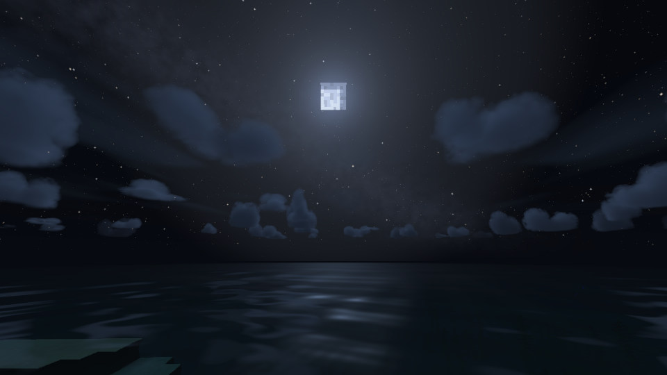
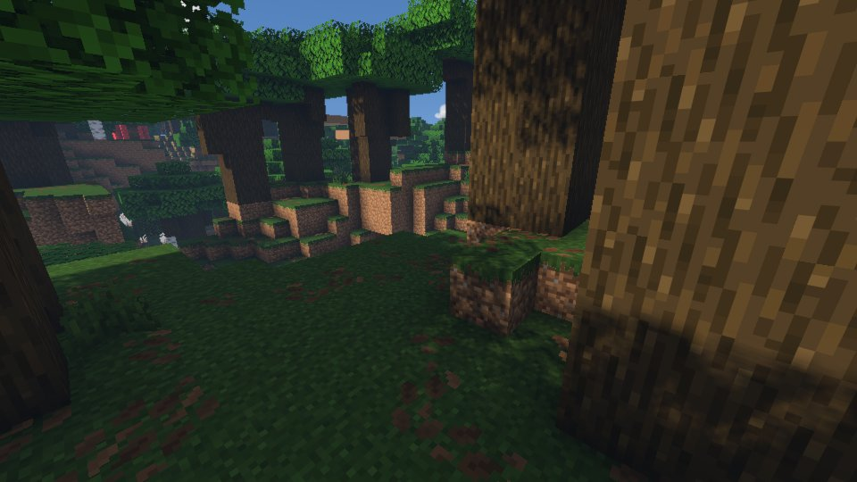

# Sunsun Shader

A native shader pack that runs on Horizon, the game client written in Rust.

An original native Horizon shader pack with warm light in the air, dark unlit
Overworld spaces, directional shadows, clear blue daylight, layered clouds and
reflective water.

**0.2.0-rc2 is a pre-release for the ordinary public Nightly. Medium is the default.**
Its five-scene comparison with rc1 follows the same world, camera, clock, weather
and settings: lantern village, torch/lava cave, rainy dusk forest, moonlit shore
and a brilliant noon control.







## Install

Tested in **Horizon Nightly 2026-11-13 · 9f42064**, the public launcher Nightly
for Minecraft Java Edition 26.3. The release uses shader API **0.1** and needs no
experimental HDR environment switch.

Download [sunsunshader-0.2.0-rc2.hshader](https://github.com/lkjsxc/sunsunshader/releases/download/v0.2.0-rc2/sunsunshader-0.2.0-rc2.hshader),
put it in the game's `shaderpacks/` folder, and select **Sunsun Shader** under
Options → Video Settings → Shaders → Shader Packs. Keep one installed Sunsun
archive. Folder installation also works as `shaderpacks/sunsunshader/`.

[rc1](https://github.com/lkjsxc/sunsunshader/releases/tag/v0.2.0-rc1) and
[0.1.1](https://github.com/lkjsxc/sunsunshader/releases/tag/v0.1.1) remain available.
This candidate deliberately makes unlit Overworld areas darker.

## Light, darkness and water

- **Light in the air:** visible torches, lanterns, lava and other emitting terrain
  seed a bounded source field. A finite camera-ray scattering integral uses real
  source positions, emission levels, light tint and scene depth. Night, low sun,
  rain, biome humidity and enclosed air increase the effect. Clear open noon
  receives none of this added local haze.
- **Dark unlit spaces:** the Overworld's ambient floor, decorative ore glow and
  cave exposure boost are removed. Fog cannot add unoccluded blue sky to a sealed
  room. The player's brightness multiplies existing faint light and preserves
  zero; native night vision and obscuring status effects remain supported.
- **Observed lunar air:** a broader aureole follows the visible native moon pixels
  and is composed behind clouds. A faint new-moon texture does not produce the
  new bright halo. Directional ground and analytic water moonlight still lack a
  native phase value; they are separate approximations.
- **Modest water refinement:** a narrower reflection cone where pixels resolve the
  water gives nearby cloud masses a little more shape. A third broad wave
  direction reduces the former two-direction rhythm without materially raising
  its unwarped slope strength. Distant filtering, the bounded visible normal,
  shore tracing, shallow refraction and highlight shoulders remain.

Existing directional sun/moon caster maps, coloured daytime shade, contact depth,
foliage transmission, anchored plant wind, eroded cumulus and the separate high
cloud layer are retained. Nether and End keep their separate dimensional
atmospheres.

## Profiles and measured cost

The **Light in the air** option is on by default. Medium and High use it; Low
retains optical bloom and skips the expensive added source/lunar sampling.
The common graph still declares four small extra passes and one extra haze
target on Low. Turning the option off is also available on Medium/High.

| Work | Low | Medium | High |
| --- | ---: | ---: | ---: |
| Shadow filter samples per map | 4 | 8 | 12 |
| Blocker-search depth samples | 0 | 8 | 12 |
| Contact-shading depth samples | 0 | 8 | 12 |
| Clear-cloud traversal cap | 8 cells | 14 cells | 22 cells |
| Density points per intersected cloud lobe | 2 | 3 | 5 |
| Reflected-cloud traversal cap | None | 10 cells | 16 cells |
| Screen-reflection depth steps | None | 12 + up to 4 refinement | 24 + up to 4 refinement |
| Visible local sources per air sample | Off | Up to 2 | Up to 3 |
| Source-path visibility depth checks, per source | Off | 2 | 4 |
| Daylight shaft samples | Off | Off | 10 |

All profiles retain a 1536×1536 shadow map with a 128-block half-distance.
Cloud traversal counts are bounds with geometric early exits; procedural density
work is arithmetic. One shadow comparison lookup performs native 2×2 PCF, with
opaque and transmitting maps sampled separately.

Local-source discovery works at one quarter of each image dimension. Its first
spread uses up to 25 field reads at 960×540 and 121 at 1920×1080; a capped search
and matching finite fade bound larger resolutions. The final gather/evaluation
uses up to 17 explicit reads on Medium or 27 on High per quarter-resolution
pixel, excluding the engine's post-input wrapper. The full
[sampling audit](https://github.com/lkjsxc/sunsunshader/releases/download/v0.2.0-rc2/sampling-costs.md)
accounts for metadata/depth reads, all passes, quality gates and target memory.

<!-- LOOK5_COSTS_BEGIN -->
| Scene | Profile | rc1 before, ms | rc2, ms | rc1 after, ms | Change vs bracket | rc1 drift |
| --- | --- | ---: | ---: | ---: | ---: | ---: |
| Night village | Medium | 217.63 | 177.66 | 180.37 | −20.46 ms / −10.33% | −17.12% |
| Night village | High | 209.87 | 215.69 | 210.35 | +5.58 ms / +2.65% | +0.23% |
| Torch/lava cave | Medium | 180.40 | 181.27 | 182.89 | −0.37 ms / −0.20% | +1.38% |
| Torch/lava cave | High | 147.12 | 155.49 | 169.75 | −2.54 ms / −1.60% | +15.38% |

The bracket reference is `sqrt(rc1_before × rc1_after)`. **Village Medium and
cave High are strongly affected by baseline drift**; their negative percentages
do not establish a speedup. Village High's observed increase is small relative
to overlapping repeat ranges, and cave Medium's difference is unresolved within
variation. Host variation prevents a precise causal overhead estimate.
<!-- LOOK5_COSTS_END -->

These are **960×540 Mesa software-renderer elapsed frame times**, using the same
published client and an eight-worker/CPU limit. Each row uses a separate
**rc1 → rc2 → rc1** bracket, with three 20-second native raw-frame samples per
block. Values are the median of the three repeat means. Both baseline sides,
their drift and repeat ranges are retained in the
[cost report](https://github.com/lkjsxc/sunsunshader/releases/download/v0.2.0-rc2/costs.md).
Bracketing reduces slow drift but does not remove shared-host or order effects.
This is a whole-pack comparison, not isolated haze cost or a hardware GPU claim.
The manifest's 4 ms at 1920×1080 remains a design target.

Other controls cover exposure, air density, clouds, shadows, terrain reflections,
wave strength, contact shading, plant wind, weather detail and bloom. Depth of
field, camera motion blur and vignette are off by default.

## Review evidence and limits

[Release and review files](https://github.com/lkjsxc/sunsunshader/releases/tag/v0.2.0-rc2)
include the installable archive, SHA-256, ordinary-game gate receipt,
[native paired sheet](https://github.com/lkjsxc/sunsunshader/releases/download/v0.2.0-rc2/contact.jpg),
[review](https://github.com/lkjsxc/sunsunshader/releases/download/v0.2.0-rc2/report.md)
and retained rounds. Each primary cell is a native 960×540 capture. The README
photographs come from those exact pack bytes; scene pixels are not repainted or
graded outside the pack. The promotional film is kept separate from this release.

The local air field sees **visible emitting terrain only**. Offscreen and fully
covered sources, including emitters hidden by glass, are outside that effect.
One source survives each seed/propagation cell before the two/three-source gather;
competition can discard a light. Screen-depth checks reduce visible obstruction
errors but cannot recover hidden geometry or provide full local-light transport.
Native block lighting still supplies its existing surface falloff and wall
occlusion.

Water is improved modestly and remains a weakness: distant cloud reflections
are soft, and a finite normal-wave spectrum still has a recognizable swell.
Offscreen shore is unavailable to screen reflections; misses use the same
procedural sky/cloud field. The native mirror has no exposed terrain mask and
contains a different sky, so it is not used. Waves affect normals/refraction,
not the water mesh.

Further public-Nightly limits remain:

- Entity materials retain native lighting; offscreen entity casters can leave
  the native shadow map.
- The world buffer is bounded gamma colour. Highlight shoulders preserve
  gradation but cannot restore HDR radiance, and native transparent surfaces
  still blend in gamma space.
- The moon keeps its native phase texture. Only the added sky aureole estimates
  phase from visible pixels; surface and water lunar light remain phase-agnostic.
- Contact shade sees visible solid terrain. Motion uses spatial filtering,
  without temporal accumulation or object-motion guides. Native precipitation
  ordering, and camera-biome snow/auroras, remain limitations.

## Build and check

Python 3.11+, Git and stable Rust are required.

```sh
python3 tools/release.py check --self-test
python3 tools/release.py build
```

Both commands validate the pinned Nightly and API 0.2 development variants
through unmodified Horizon validators. `--target nightly` builds this 0.2.0-rc2
release. The separate `pack-main/` remains the 0.1.1 development visual baseline;
it is not the public Nightly download.

The ordinary-game admission check matters: the standalone Nightly parser accepts
experimental features the ordinary game refuses. CI includes negative refusal
tests and exact packed-file checks. The permanent source tag is
`nightly-source/2026-11-13-9f42064`; distribution/source policy identities are
pinned in [compatibility/horizon.json](compatibility/horizon.json).

After validating and reviewing the final bytes, publish with:

```sh
python3 tools/release.py release dist/sunsunshader-0.2.0-rc2.hshader --notes release-notes.md --prerelease
```

Publication rechecks those bytes, rebuilds for byte identity, and refuses a dirty
checkout, an unpushed source commit or a mismatching tag. Release candidates are
always pre-releases. See [tools/README.md](tools/README.md) for the gate and pin
maintenance.

All shader code is original and Apache-2.0 licensed. Published mathematical
methods are credited in source comments; no other shader pack is used as source.
