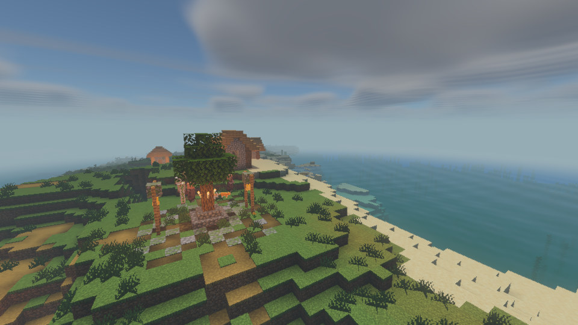
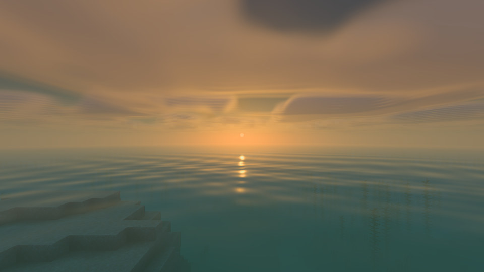
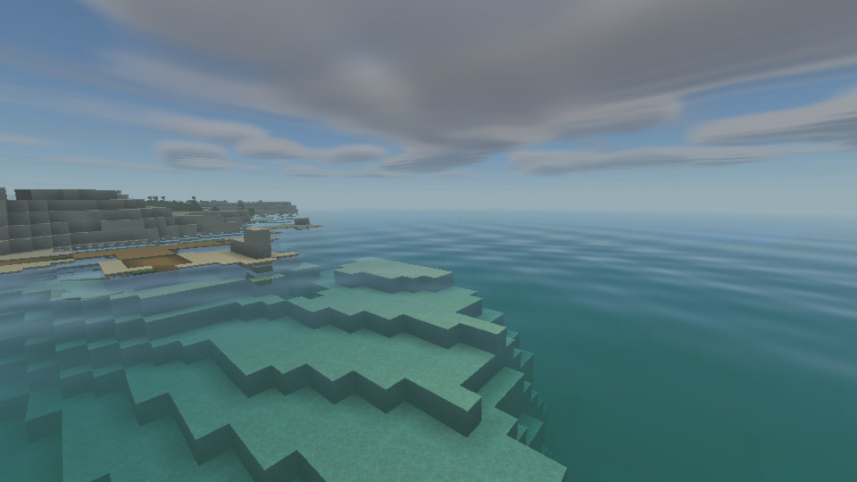
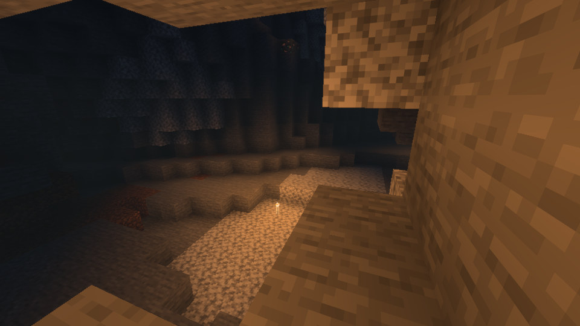

# Sunsun Shader

A native Horizon shader pack with warm daylight, cool shade, soft clouds and clear water.







## Install

Requires **Horizon shader API 0.2**. Tested with Horizon
[`5c9c56be8c14e42b8a32ac52aac53ce26e159ecc`](https://github.com/horizon-rust/horizon/tree/5c9c56be8c14e42b8a32ac52aac53ce26e159ecc)
for Minecraft Java Edition 26.3. The shader API is experimental.

Copy this repository's folder into your game directory's `shaderpacks/`, then select **Sunsun Shader** in
Video Settings → Shaders → Shader Packs. Alternatively, build an installable archive with Horizon's tool:

```sh
horizon-shader check sunsunshader
horizon-shader pack sunsunshader --out sunsunshader-0.1.0.hshader
```

Put the resulting `.hshader` into `shaderpacks/`. Keep only one installed copy.

## Profiles and options

**Medium is the default.** Profiles change cloud, shadow-filter, reflection, light-shaft and edge-filter work.

| Profile | Cloud samples | Shadow filter | Water terrain reflection |
|---|---:|---:|---|
| Low | 6 | 4 taps | Sky only |
| Medium | 12 | 8 taps | Screen space |
| High | 18 | 12 taps | Screen space; optional experimental rays |
| Ultra | 28 | 16 taps | Longer screen search; optional experimental rays |

High and Ultra also reflect the cloud volume. The shadow map is 1536×1536 in every profile.
Ray reflections are off by default. They require High or Ultra and a ray-capable Horizon device;
screen space remains the fallback.

| Option | Effect |
|---|---|
| Exposure | Overall brightness with mild, slow adaptation. |
| Air density | Distance haze and low fog. |
| Clouds | Low cloud volumes, high cirrus and cloud shade. |
| Shadows | Filtered terrain and entity shadows. |
| Terrain reflections | Terrain in water; sky reflection remains. |
| Ray reflections | Experimental High/Ultra ray queries; off by default. |
| Weather detail | Wet surfaces, a light cold-biome snow coat, rainbows and auroras. |
| Bloom | Wide glow around bright light. |
| Depth of field | Focus at the screen centre; off by default. |
| Camera motion blur | Blur from camera movement; off by default. |
| Vignette | Slightly dim corners; off by default. |

The manifest's **4 ms at 1920×1080** budget is a Medium design target, not a measured result.
No hardware GPU timing is available. Horizon can maintain its ray scene on capable hardware in every profile
when ray tracing is enabled, even with Ray reflections off. The option gates queries, not scene allocation.
A Lavapipe run crashed after switching to ray-enabled High; no ray-rendered image was verified and the cause
is unresolved. `HORIZON_RAY_TRACING=0` disables that engine path entirely.

## Current limits

The moon retains Horizon's phase texture. Custom lunar orbits, eclipses and lightning inside clouds are absent.
Screen-space reflections cannot see offscreen terrain; Low and Medium reflect the atmospheric continuum without
cloud volumes. Water waves change normals and refraction, not the mesh. Caustics are a soft procedural bed pattern.

Snow and auroras use the biome at the camera because per-surface biome data is unavailable. Wet ground has sky
and sun gloss, not terrain reflections. Dropped and framed items, particles and the first-person hand retain engine lighting;
some native draws can receive additional post fog. Temporal accumulation and object motion blur are absent.

Screenshots are actual frozen Horizon frames rendered with Mesa Lavapipe, at 960×540 and ten chunks.
They demonstrate appearance, not GPU performance.

## Development

CI builds the pinned Horizon validator, checks the source, packages it, then checks the archive.
All shader code is original and licensed under Apache-2.0. Published methods are credited in source comments.
