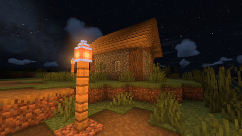
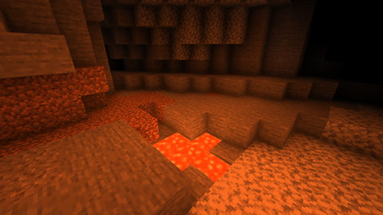
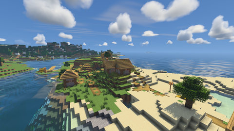
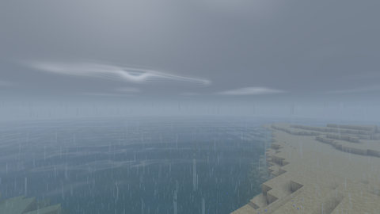
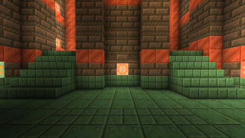
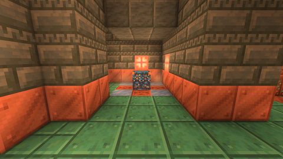
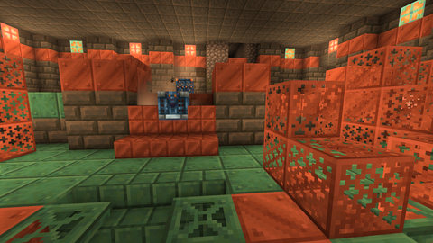
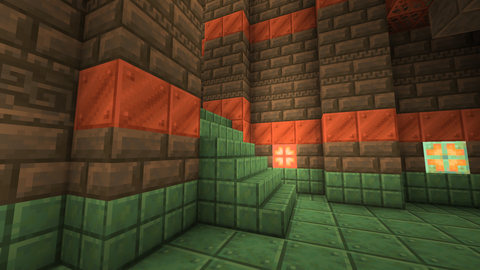

# Sunsun Shader 0.2.0-rc5 gallery

These 1920×1080 SDR screenshots use the released rc5 pack, Medium profile and
Horizon Nightly 2026-11-19 · 5ef7734. The renderer is Mesa llvmpipe (Vulkan).
Select a thumbnail for the full-size image.
[Capture and scene settings](gallery-capture.md)

Oak-fence lantern posts beside a village house at midnight.

Warm west horizon glow, reflected clouds, and shallow seabed.

A small lava pool lights the cave floor below a dark passage.

Coastal village and far hills in mid-afternoon.

Afternoon rain and mist over the sea and a sandy shore.

## Trial chambers

Tuff-brick trial-chamber stair hall with copper stairs on both sides and a lit copper bulb between them.

Trial spawner at the end of a narrow corridor below a copper bulb in the end wall.

Inactive vault on a raised copper platform among copper grates and high wall bulbs.

Two lit waxed copper bulbs on one wall at similar camera distance, with a stronger warm glow beside the unoxidized bulb than the weathered one.
